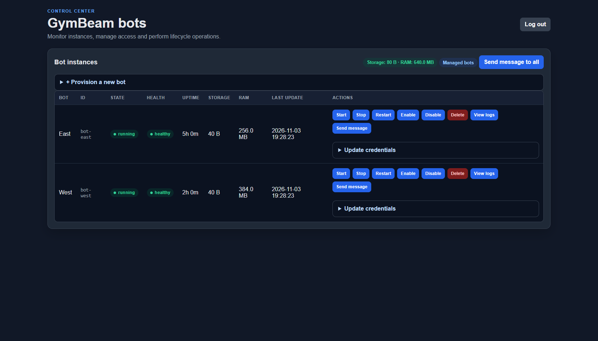
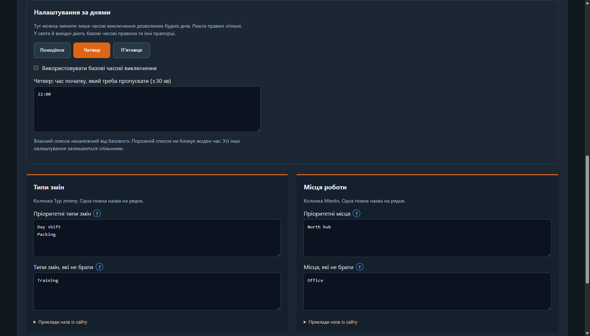
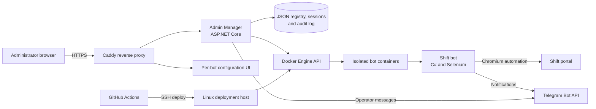

# GymBeam Shifts Automation

[](https://github.com/krustallik/GymbeamShifts/actions/workflows/ci.yml)

A C# automation system that monitors a third-party shift portal, filters and prioritizes available shifts, and registers matching shifts through Selenium. It also includes a separate ASP.NET Core manager for operating multiple isolated bot instances.

This is an independent project and is not affiliated with or endorsed by GymBeam.

## What it does

The repository contains two .NET applications:

- **Shift bot** signs in to the portal with a configured account, scans paginated shift listings, applies date, weekday, holiday, start-time, lead-time, shift-type, and location rules, and attempts to register eligible shifts. It sends status and shift notifications through the Telegram Bot API.
- **Admin Manager** provides an authenticated dashboard for multiple bot instances. It can inspect health and resource use, view bounded logs, control container lifecycle, update credentials, provision or remove instances, and send Telegram messages.

The bot's configuration UI is served by the bot itself. Each bot has its own configuration, credentials, and runtime data.

## Screenshots

The screenshots below show the real application interfaces running locally with synthetic demonstration settings and status data. They do not show live accounts or production data.

### Multi-instance operations dashboard



### Per-bot shift rules



## Engineering highlights

- **Resilient browser workflow:** selects 100 rows per page, scans up to five pages, stores stable shift identifiers rather than relying on stale DOM elements, and rebuilds the listing after a registration changes pagination.
- **Explicit business rules:** supports overnight shift ranges, inclusive ±30-minute start-time exclusions, independent weekday overrides with inheritance, holiday/weekend rules, lead-time thresholds, and type/location prioritization.
- **Safe multi-instance management:** validates bot identifiers and provisioning inputs, isolates each instance's files, coordinates lifecycle operations, and uses transaction records with startup recovery for provisioning and credential changes.
- **Web security controls:** authenticated sessions, CSRF checks, login rate limiting, security headers, PBKDF2 password verification, bounded log responses, and escaped dashboard output.
- **Recoverable delivery:** GitHub Actions validates the .NET solution and deployment configuration. The SSH deployment script snapshots managed containers and images, checks health, and restores the previous state on failure.

## Architecture



The Admin Manager stores its registry, sessions, and audit events in JSON/JSONL files; the project does not use a relational database. See [Architecture](docs/ARCHITECTURE.md) for component responsibilities and runtime flows.

## Technology

| Responsibility | Technologies |
|---|---|
| Applications | C#, .NET 8, ASP.NET Core minimal APIs |
| Bot interface | Server-rendered HTML, CSS, and JavaScript |
| Portal automation | Selenium WebDriver, Chromium |
| Tests | xUnit, Moq, Selenium workflow tests |
| Operations | Docker Engine, Docker Compose, Caddy |
| Notifications | Telegram Bot API |
| Persistence | JSON and JSONL files with atomic writes and recovery |
| Delivery | GitHub Actions, SSH, health checks, snapshot and rollback scripts |

## Build and test

Install the .NET 8 and .NET 9 SDKs. The applications target .NET 8; the shift-bot test project targets .NET 9, while the Admin Manager tests target .NET 8. Selenium workflow tests also need a compatible local Chrome or Chromium installation.

```bash
git clone https://github.com/krustallik/GymbeamShifts.git
cd GymbeamShifts
dotnet restore GymBeamShiftsController.sln
dotnet build GymBeamShiftsController.sln --configuration Release --no-restore
dotnet test GymBeamShiftsController.sln --configuration Release --no-build
dotnet format GymBeamShiftsController.sln --verify-no-changes --no-restore
```

The full test suite covers the bot's parsing and eligibility rules, Selenium workflows and administration UI, plus the manager's authentication, persistence, provisioning, lifecycle, and deployment behavior. The latest local portfolio verification ran **501 tests successfully**; see [Development](docs/DEVELOPMENT.md) for the test split and environment notes.

## Running and configuration

The shift bot requires a portal account and Telegram credentials. The Admin Manager requires its own signing key and password hash, persistent storage paths, and access to the Docker socket for live container operations. Do not use production credentials for local evaluation.

Safe placeholder files are in [`deploy/examples/`](deploy/examples/). The checked-in Compose stack is designed for a Linux host with prepared instance directories and Caddy routing; it binds ports 80 and 443 and can manage Docker containers. Do not start it on a machine with valuable Docker workloads or existing instance data without first preparing a separate host or isolated Docker environment.

- [Local development and tests](docs/DEVELOPMENT.md)
- [Docker workflow and its prerequisites](DOCKER_RUN.md)
- [Deployment and recovery runbook](DEPLOY.md)
- [Architecture and data flows](docs/ARCHITECTURE.md)

## Project status and limitations

- Portal automation depends on the third-party website's DOM and login flow. Website changes can require parser or selector updates.
- A working bot run requires valid portal and Telegram credentials; the repository does not provide a public demo account.
- Container provisioning and lifecycle management require a Linux Docker Engine and Caddy admin socket configured for the deployment environment.
- The included deployment workflow is not a hosted public demo. No public service availability or business-impact metrics are claimed here.
- Some bot administration and orchestration code remains concentrated in service classes; the existing code is documented as-is rather than refactored for this portfolio pass.

## Repository layout

```text
GymBeamShiftsControllerX/        Shift bot, parser, rules, and per-bot admin UI
GymBeamShiftsControllerX.Tests/  Bot unit, integration, and Selenium workflow tests
GymBeam.AdminManager/            Multi-instance ASP.NET Core manager
GymBeam.AdminManager.Tests/      Manager security, persistence, and integration tests
deploy/examples/                 Placeholder-only runtime configuration examples
scripts/                         Deployment, rollback, and validation scripts
docs/                            Architecture, development notes, and screenshots
.github/workflows/ci.yml         CI validation and protected SSH deployment
DEPLOY.md                        Deployment and recovery runbook
DOCKER_RUN.md                    Compose-specific operational notes
```

## Independent project

This repository demonstrates browser automation, rule-driven data processing, secure administration endpoints, container lifecycle management, persistence and recovery, automated testing, and deployment scripting. It is a personal project and is not an official GymBeam service.
