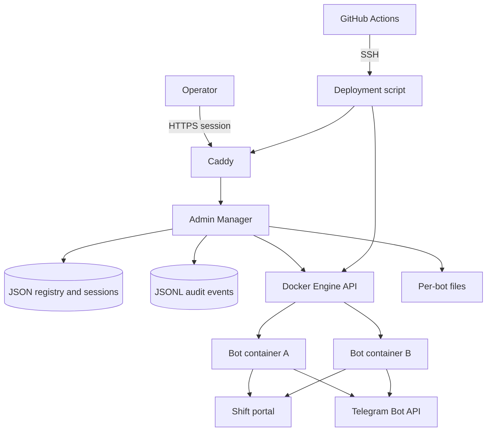

# Architecture

The repository contains two .NET 8 applications that share the bot's deployment image but have separate responsibilities.

## Components

| Component | Responsibility | State and integrations |
|---|---|---|
| Shift bot | Authenticates to the shift portal, scans listings, applies selection rules, attempts registration, and sends notifications | Per-instance `appconfig.json`, `.env`, and runtime log; Selenium/Chromium; portal; Telegram Bot API |
| Bot administration UI | Allows an operator to inspect status and update rules for one bot | Served by that bot; persists rules in its instance `appconfig.json` |
| Admin Manager | Authenticates operators and manages multiple bot instances, credentials, logs, lifecycle, provisioning, routes, and manual Telegram messages | JSON registry/session files, JSONL audit log, Docker Engine API, Caddy admin socket, per-instance files |
| Caddy | Terminates HTTPS and routes the manager and dynamically provisioned bot hostnames | Main Caddyfile and generated route files |
| GitHub Actions | Restores, builds, tests, validates deployment configuration, and runs protected deployment on eligible pushes to `main` | GitHub Environment SSH secrets; deployment host repository checkout |

There is no relational database. Bot rules and instance credentials are kept separately for each bot. The manager uses atomic file replacement and transaction records for sensitive multi-step updates.

## Shift scan and registration flow

```mermaid
sequenceDiagram
    participant Bot as Shift bot
    participant Browser as Chromium / Selenium
    participant Portal as Shift portal
    participant Rules as Instance rules
    participant Telegram as Telegram API

    Bot->>Browser: Refresh authenticated shift page
    Browser->>Portal: Load and sort shift listings
    loop Up to five pages, with up to 100 rows per page
        Bot->>Browser: Read shift rows and stable identifiers
        Browser-->>Bot: Parsed date, start/end, location, type, registration control
    end
    Bot->>Rules: Read current shared and per-day rules
    Bot->>Bot: Filter exclusions and lead time; prioritize remaining shifts
    Bot->>Browser: Re-open page and locate current control by shift identifier
    Browser->>Portal: Attempt registration
    Portal-->>Browser: Updated availability/listing
    Bot->>Browser: Refresh and rebuild listing after a successful registration
    Bot->>Telegram: Send configured status or shift notification
```

The parser handles combined time ranges, including shifts that cross midnight. For eligible weekdays, a per-day start-time list can be independent or inherit the current shared list. Weekends and listed holidays use the shared weekend/holiday rules. Other filters remain shared across dates.

## Manager and deployment flow



Admin Manager mutations are coordinated so lifecycle, provisioning, credential, and deletion operations do not race each other. Provisioning and credential updates record transaction state and have recovery paths for interrupted operations. Docker and Caddy access are routed through dedicated validation and adapter services rather than exposing arbitrary user-supplied commands.

## Deployment and rollback

The workflow in `.github/workflows/ci.yml` validates the solution and deployment artifacts before the protected deployment job runs. `scripts/deploy.sh` creates a timestamped snapshot, validates Compose and Caddy configuration, builds the bot and manager images, recreates containers carrying the managed-bot labels, verifies health, and checks the configured public manager health endpoint. An error triggers `scripts/rollback.sh` for the snapshot. See [DEPLOY.md](../DEPLOY.md) for the operator runbook.

## Security boundaries

- Portal and Telegram credentials stay in per-instance environment files; they are not part of the checked-in examples.
- The Admin Manager uses signed sessions, CSRF protection, login rate limiting, security headers, PBKDF2 password hashes, and bounded log responses.
- The manager image runs as an unprivileged user with a read-only root filesystem and dropped Linux capabilities in the Compose definition. It still has access to the Docker socket for its management role, so that host-level boundary must be treated as privileged.
- Caddy provides public HTTPS routing; application endpoints are not intended to be exposed directly on public ports.
- Deployment credentials are supplied to GitHub Actions through a protected environment. The deployment host separately needs repository read access.
